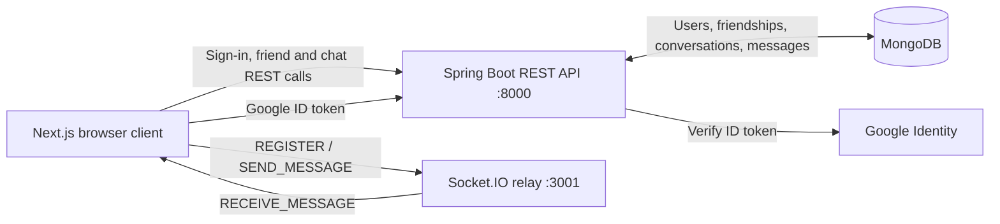

# Connect — Real-Time Chat

> A full-stack, one-to-one chat application with account sign-in, friend requests, persistent conversations, and live message delivery.

The repository contains three applications: a **Next.js** web client, a **Spring Boot** REST API backed by **MongoDB**, and a small **Socket.IO** relay for real-time message delivery.

**Jump to:** [Features](#whats-inside) · [Tech stack](#tech-stack) · [Architecture](#architecture) · [Application flow](#application-flow) · [API and events](#api-and-real-time-routes) · [Run locally](#run-locally) · [Checks](#checks)

## What's inside

| Area | Capabilities |
| --- | --- |
| **Accounts** | Email/password sign-in and Google sign-in; API support for registration |
| **Connections** | Find users by username, send and respond to friend requests, and list accepted friends |
| **Conversations** | Create or reuse one-to-one conversations and load their message history |
| **Messaging** | Save messages and conversation previews in MongoDB, then relay new messages live |
| **Dashboard** | Browse chats and requests, search lists, view connection status, and sign out |

> **Current scope:** Group conversations are shown as coming soon in the dashboard. The signup route currently presents a form, but does not submit it to the registration API.

## Tech stack

| Layer | Technologies |
| --- | --- |
| Web client | Next.js 16 App Router, React 19, TypeScript 5 |
| UI styling | CSS, Tailwind CSS 4/PostCSS |
| HTTP API | Java 21, Spring Boot 4, Spring MVC, Spring Security |
| Persistence | MongoDB with Spring Data MongoDB |
| Authentication | JWT (JJWT), BCrypt password hashing, Google OAuth ID-token verification |
| Real-time delivery | Node.js, Express 5, Socket.IO 4 |
| Quality tools | ESLint 9, Maven, JUnit / Spring Boot Test |

## Architecture



The browser is the coordinator: it uses the Spring API for authenticated operations and durable data, and uses the Node relay to notify a recipient's currently registered socket. The Socket.IO relay is **not** the source of truth for message history.

## Application flow

### 1. Sign in

The home route redirects to `/auth/signin`.

- **Email/password:** the client posts credentials to `POST /api/user/login`. The backend checks the BCrypt hash and returns an application JWT and user details.
- **Google:** the client sends the Google ID token to `POST /api/auth/google`. Spring verifies the token against the configured Google client ID, finds or creates the account, then issues its own application JWT. The Google token is not used as the API access token.
- The client saves the application token as `accessToken` and a minimal user object as `user` in `sessionStorage`, then navigates to `/dashboard`.

The dashboard redirects to sign-in if either saved value is missing. Authenticated REST calls include `Authorization: Bearer <token>`. The backend JWT currently expires after one hour.

### 2. Load the dashboard and connections

On entry, the dashboard loads incoming requests, pending relationships, accepted friends, and the current user's conversations. It gets the current user identity from the JWT-backed Spring Security `Authentication`.

To add someone, the client resolves their username to a user ID, then submits a friend request. The receiver can accept or reject it. Accepting a request marks the friendship as accepted and creates or reuses a one-to-one conversation.

### 3. Open a conversation and load history

Selecting a friend calls `POST /api/chats/{userId}`. The backend returns an existing one-to-one conversation or creates one, after which the client loads `GET /api/chats/{conversationId}/messages`. The backend checks that the signed-in user belongs to that conversation before returning history.

### 4. Send and receive a message

1. The client posts the conversation ID, recipient ID, and message content to `POST /api/chats/{conversationId}/messages` with its bearer token.
2. Spring resolves the sender from the authenticated identity, checks that both users belong to the one-to-one conversation, saves the message, and updates the conversation's last-message preview in MongoDB.
3. After the REST call succeeds, the client emits `SEND_MESSAGE` to the Socket.IO relay.
4. The relay looks up the recipient's registered socket and emits `RECEIVE_MESSAGE`.
5. The recipient reloads the conversation history from the REST API and refreshes the conversation list.

If the recipient is not connected and registered with the relay, delivery reports an error. Durable history remains in MongoDB and is available when the conversation is reloaded.

### 5. Sign out

Sign-out clears the client-side session values, disconnects the socket, and returns to `/auth/signin`.

## API and real-time routes

The REST API runs on port **8000** by default. Login, registration, and Google login are public; other routes require authentication.

| Method | Route | Purpose |
| --- | --- | --- |
| `POST` | `/api/user/register` | Register an account (API endpoint) |
| `POST` | `/api/user/login` | Sign in with email and password |
| `POST` | `/api/auth/google` | Exchange a verified Google ID token for an app JWT |
| `GET` | `/api/user/me` | Get the current user |
| `GET` | `/api/user/search/{username}` | Search users by username |
| `GET` | `/api/friends?Status=PENDING` | List pending friendships |
| `GET` | `/api/friends?Status=ACCEPTED` | List accepted friends |
| `GET` | `/api/friends/requests` | List received friend requests |
| `GET` | `/api/friends/requests/sent` | List sent friend requests |
| `GET` | `/api/friends/getFriendId/{username}` | Resolve a username to a user ID |
| `POST` | `/api/friends/requests/{friendId}` | Send a friend request |
| `PUT` | `/api/friends/requests/{requestId}/accept` | Accept a request and create/reuse a chat |
| `PUT` | `/api/friends/requests/{requestId}/reject` | Reject a request |
| `DELETE` | `/api/friends/requests/{requestId}` | Delete a pending request |
| `GET` | `/api/chats` | List the signed-in user's conversations |
| `POST` | `/api/chats/{userId}` | Create or get a one-to-one conversation |
| `GET` | `/api/chats/{conversationId}/messages` | Load conversation history |
| `POST` | `/api/chats/{conversationId}/messages` | Persist a message and update conversation preview |

The active dashboard Socket.IO flow uses these events:

| Direction | Event | Purpose |
| --- | --- | --- |
| Client → relay | `REGISTER` | Associate the connected socket with a user ID |
| Client → relay | `SEND_MESSAGE` | Ask the relay to forward a message |
| Relay → recipient | `RECEIVE_MESSAGE` | Notify the recipient of a new message |
| Relay → sender | `DELIVERY_ERROR` | Report that the recipient is not registered |

## Repository layout

```text
.
├── backend/
│   ├── src/main/java/com/chat/app/
│   │   ├── controller/       # REST endpoints
│   │   ├── services/         # Authentication, chat, friendship, message logic
│   │   ├── entity/           # MongoDB domain models
│   │   ├── repository/       # Spring Data repositories
│   │   ├── security/         # JWT service and request filter
│   │   ├── config/           # Spring, CORS, OAuth and STOMP configuration
│   │   └── WebSocket/        # STOMP message controller
│   ├── src/main/resources/   # Spring application configuration
│   └── about/                # Backend endpoint and project notes
├── frontend/
│   └── src/app/
│       ├── auth/             # Sign-in, Google provider and signup UI
│       ├── dashboard/        # Chat, requests, and message interface
│       ├── header/           # Shared navigation
│       └── lib/              # Socket client helper
└── websockets_server/
    └── server.js             # Socket.IO relay
```

## Run locally

### Prerequisites

- Java 21
- Node.js and npm
- A MongoDB database (local or Atlas)
- A Google OAuth client ID if you want to use Google sign-in

Run each component in its own terminal from the repository root.

### 1. Configure the backend

Provide your own MongoDB connection URI and matching Google OAuth client ID. The backend reads these Spring properties from the environment:

```powershell
$env:SPRING_DATA_MONGODB_URI = "mongodb+srv://<user>:<password>@<cluster>/chat_db?retryWrites=true&w=majority"
$env:GOOGLE_CLIENT_ID = "<your-google-oauth-client-id>"
```

The current Mongo template uses the database name `chat_db`; make sure the database configuration in `backend/src/main/java/com/chat/app/config/AppConfig.java` matches the database you intend to use.

### 2. Start the Spring Boot API

```powershell
Set-Location .\backend
.\mvnw.cmd spring-boot:run
```

The API listens on `http://localhost:8000`.

### 3. Start the Socket.IO relay

The server defaults to port 3000, which is also the usual Next.js development port. Set the relay to **3001** to match the dashboard's current connection URL:

```powershell
Set-Location .\websockets_server
npm ci
$env:PORT = "3001"
node .\server.js
```

The package's `dev` script references `nodemon`, which is not declared in this package's dependencies; `node .\server.js` works without that extra tool.

### 4. Configure and start the frontend

Create `frontend/.env.local`:

```dotenv
NEXT_PUBLIC_API_URL=http://localhost:8000
NEXT_PUBLIC_GOOGLE_CLIENT_ID=<your-google-oauth-client-id>
```

Use the same Google OAuth client ID as the backend. Then start Next.js:

```powershell
Set-Location .\frontend
npm ci
npm run dev
```

Open `http://localhost:3000`.

`NEXT_PUBLIC_SOCKET_URL` is used by the socket helper in `src/app/lib/socket.ts`, but the dashboard currently connects directly to `http://localhost:3001`; changing that variable alone will not change the dashboard connection.

## Checks

From the corresponding application directory:

```powershell
# Frontend lint and production build
npm run lint
npm run build

# Backend tests
.\mvnw.cmd test
```

The backend test suite currently contains a Spring application-context smoke test. The Socket.IO package does not define a test script.

## Implementation notes

- MongoDB stores users, friendships, and messages; conversation documents store participant IDs and the last-message preview.
- The Google client ID must be set in both the frontend and backend configuration. The current global frontend provider requires `NEXT_PUBLIC_GOOGLE_CLIENT_ID` even if you do not use Google sign-in.
- The backend also configures a Spring STOMP endpoint at `/ws` and a `/app/chat.send` message mapping. The current dashboard does **not** use this path; it uses the separate Socket.IO relay described above.
- The Socket.IO relay keeps user-to-socket registrations in memory and does not authenticate the registration event. It is a development/demo relay, not a production-ready presence or delivery service.
- The JWT signing key is currently hard-coded in `JwtService`; the `jwt.secret` property in Spring configuration is not currently wired into that service. Replace this with a securely managed secret before deployment, and never commit database credentials or private secrets.